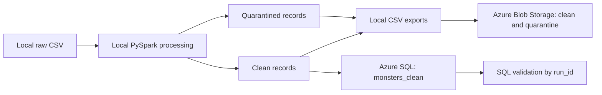

# MonsterForge | Azure Data Engineering Pipeline

A Python and PySpark portfolio project that turns messy monster inventory records into clean, queryable data using Azure Blob Storage and Azure SQL Database.

The project demonstrates data profiling, ordered transformations, data quality checks, quarantine handling, cloud storage integration, and SQL loading with run-level traceability. Spark runs locally; Azure provides storage and the SQL destination.

## Architecture



The SQL loader reads the exported clean CSV through pandas. Blob outputs include both a latest copy and a timestamped run copy. The current pipeline reads its input from the local filesystem; raw Blob ingestion is not wired into the main run.

## Technologies

| Technology | Role |
| --- | --- |
| Python | Pipeline orchestration and helper utilities |
| PySpark | Profiling, transformations, and clean/quarantine separation |
| pandas | CSV export and SQL loading |
| Azure Blob Storage SDK | Uploading processed datasets |
| Azure Identity | Storage authentication through `DefaultAzureCredential` |
| Azure SQL Database | Relational destination for clean records |
| SQLAlchemy and pyodbc | SQL connection, insertion, and validation |
| python-dotenv | Local environment configuration |

## Dataset and saved results

The included file, `data/raw/MonsterForge_monsters_raw_100.csv`, contains **105 records**, despite the `100` in its filename. Its seven input fields are monster ID, name, type, danger level, created date, base price, and status.

The data includes inconsistent capitalization, whitespace, currency formatting, mixed date formats, missing values, and duplicate records.

The saved local output in `output/run_id=20260718_223746/` contains:

| Output | Rows |
| --- | ---: |
| Clean records | 84 |
| Quarantined records | 21 |
| Total | 105 |

These counts describe the checked-in local CSV artifacts. They are not evidence of the current state of Azure resources.

## Transformations and data quality

The transformation function applies the following rules:

- Normalize column names to lowercase with underscores.
- Trim string values and convert empty strings to nulls.
- Uppercase monster IDs, title-case monster names, and lowercase monster types and statuses.
- Preserve the source date, danger level, and price in `preserve_date`, `preserve_danger`, and `preserve_price` before type conversion.
- Remove dollar signs, commas, and the handled `USD` prefix from prices, then cast to a numeric value.
- Flag negative prices with `original_price_negative` and convert them to positive values.
- Parse dates using five formats: `M/d/yy`, `yyyy-MM-dd`, `yyyy/MM/dd`, `MMM d yyyy`, and `MM-dd-yyyy`.
- Cast danger levels to integers and replace values outside 1–10 with nulls.
- Attempt to flag duplicate complete rows using grouping and a join.

Records are quarantined when the monster name, parsed date, or danger level is null, or when `duplicate_row` is true. Other records enter the clean dataset. Duplicate monster IDs are reported separately; the quarantine rule is based on complete rows, not ID uniqueness. Missing prices, types, and statuses are not explicit quarantine criteria.

Console reports show row counts, duplicate IDs, nulls, blanks, distinct values, and before/after previews.

## Repository layout

```text
monsterforge-azure-data-engineering/
├── src/
│   ├── azure/
│   │   ├── authentication.py       # DefaultAzureCredential helper
│   │   └── storage.py              # Main ETL implementation
│   ├── azure_sql_loader.py         # SQL connection and append loader
│   ├── config/settings.py         # Storage account configuration
│   └── utils/                     # SDK introspection and hierarchy helpers
├── data/
│   ├── raw/                       # Source monster CSV
│   └── object_explorer/           # Generated SDK exploration artifacts
├── output/                        # Local CSVs organized by run ID
├── notes/images/                  # Development screenshots and diagrams
├── archive/                       # Earlier exploration artifacts
├── storage_with_run_safely.py      # Alternate error-handling implementation
├── requirements.txt
├── .env.example                   # Currently empty; use the example below
└── README.md
```

The `configs`, `docs`, `scripts`, `tests`, and `src/etl` directories currently serve as placeholders.

## Setup

Run commands from the project root. The existing virtual environment records Python 3.13.1; installed package metadata also records PySpark 4.1.2, SQLAlchemy 2.0.51, and pyodbc 5.3.0. This is an observed development environment, not a tested compatibility matrix.

### 1. Create an environment and install dependencies

```powershell
python -m venv .venv
.\.venv\Scripts\Activate.ps1
python -m pip install -r requirements.txt
python -m pip install pyspark==4.1.2 SQLAlchemy==2.0.51 pyodbc==5.3.0
```

PySpark, SQLAlchemy, and pyodbc are imported by the pipeline but are currently missing from `requirements.txt`. Install a Java runtime supported by the selected PySpark version and Microsoft ODBC Driver 18 for SQL Server separately. Ensure Java is available to Spark.

### 2. Configure Azure resources and credentials

Provide an Azure Storage account with existing `clean` and `quarantine` containers, plus an Azure SQL database. The main module also creates clients for `raw` and `reports`, but does not use those containers in its main execution path. The code does not provision Azure resources.

Create a local `.env` file:

```dotenv
AZURE_STORAGE_ACCOUNT=your_storage_account_name
AZURE_SQL_USER=your_sql_username
AZURE_SQL_PASSWORD=your_sql_password
```

Storage uses `DefaultAzureCredential`. For local development with Azure CLI installed, sign in using:

```powershell
az login
```

Give the signed-in identity Blob data access sufficient for uploads, such as Storage Blob Data Contributor at the appropriate scope. Configure Azure SQL network access and grant the SQL user permission to insert into the target table, and to create it if relying on pandas to create it on the first load.

In `src/azure_sql_loader.py`, change the hard-coded SQL `host` and `database` in `get_azure_sql_engine()` to your own resources. SQL uses the username and password from `.env`; it does not use the Storage identity. Keep credentials out of source control; `.env` is ignored.

### 3. Correct the input path

In `src/azure/storage.py`, replace the machine-specific `local_file` value with:

```python
local_file = str(Path.cwd() / "data" / "raw" / "MonsterForge_monsters_raw_100.csv")
```

The existing path contains `monsterfroge`, which differs from this repository's `monsterforge` folder name. The alternate script has the same issue in `LOCAL_FILE`.

### 4. Run the main pipeline

After completing the configuration above:

```powershell
python -m src.azure.storage
```

This runs profiling, transformation, local export, Blob uploads, SQL loading, and SQL validation. The command writes to the configured Azure destinations. The main module also starts Spark and reads the CSV at import time.

## Outputs and SQL validation

Each run uses a timestamp ID in the form `YYYYMMDD_HHMMSS`.

Local exports:

```text
output/run_id=<run_id>/monsters_clean.csv
output/run_id=<run_id>/monsters_quarantine.csv
```

Blob paths within the respective containers:

```text
clean/
  monsters/latest/monsters_clean.csv
  monsters/runs/run_id=<run_id>/monsters_clean.csv
quarantine/
  monsters/latest/monsters_quarantine.csv
  monsters/runs/run_id=<run_id>/monsters_quarantine.csv
```

The loader appends clean rows to `monsters_clean`, adding `run_id` to each row. It retries SQL `OperationalError` failures up to three total attempts, with a ten-second delay between attempts.

The validation step calculates clean row count, distinct monster types, distinct statuses, and average price for the current run. To inspect a run manually:

```sql
SELECT
    COUNT(*) AS clean_rows,
    COUNT(DISTINCT monster_type) AS monster_types,
    COUNT(DISTINCT status) AS statuses,
    ROUND(AVG(base_price), 2) AS average_price
FROM monsters_clean
WHERE run_id = '<run_id>';
```

## Current limitations and next steps

This repository captures a working-development portfolio project with saved output artifacts. A fresh end-to-end cloud execution has not been verified as part of this documentation update.

- **Reproducibility:** complete the dependency manifest and move input paths and SQL connection targets into configuration.
- **Failure reporting:** the main pipeline catches SQL errors but still prints a success summary. Check the actual error logs and validation results before treating a run as successful.
- **Alternate runner:** `storage_with_run_safely.py` is experimental. Its checks treat `None` as failure even for successful functions that return `None`, including pandas CSV export and the current SQL loader.
- **Duplicate handling:** the complete-row join uses ordinary equality, so rows containing nulls may not receive a duplicate flag. Add explicit ID and null-safe duplicate policies.
- **Price parsing:** the direct numeric cast can fail on malformed prices under Spark ANSI behavior; use tolerant parsing with explicit quality rules.
- **Load behavior:** SQL inserts append on every run. Reprocessing input can add duplicate business records; no merge or upsert is implemented.
- **Scale:** exports use `toPandas()`, bringing data into driver memory. Distributed writes would be needed for larger datasets.
- **Validation:** SQL checks report aggregates rather than asserting expected results. Automated tests are not yet implemented.

Future improvements include raw Blob ingestion, quarantine reason codes, automated transformation tests, structured run status, and scheduled orchestration.
